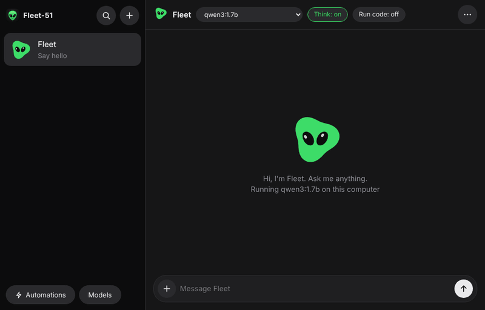

<p align="center"></p>

<h1 align="center">Fleet-51</h1>

<p align="center">
  <a href="https://github.com/noisyloop/Fleet-51/actions/workflows/build.yml"></a>
  <a href="https://github.com/noisyloop/Fleet-51/releases/latest"></a>
  
  
  <a href="LICENSE"></a>
  
</p>

<p align="center"><b>Your own fleet of alien AI bots, running privately on your computer.</b><br>
Create a bot, give it a name and a face, pick a free model, and chat. Run as many as you like at once.</p>

<p align="center"><a href="https://github.com/noisyloop/Fleet-51/releases/latest/download/Fleet-51-macos.dmg"><b>Download for Mac</b></a> · <a href="https://github.com/noisyloop/Fleet-51/releases/latest/download/Fleet-51-windows-setup.exe"><b>Download for Windows</b></a> · free and open source</p>

**Why local bots?** Your chats, files and automations never leave your computer. There's no account,
no subscription, no usage limit, and it keeps working on a plane.




| Create a bot | On a phone |
|---|---|
|  |  |

## What's new in 0.5.2

- **A much smaller first setup on Windows:** Fleet-51 now downloads about 40 MB of Ollama instead
  of 1.4 GB. It leaves out NVIDIA's CUDA libraries and runs models on the graphics card through
  Vulkan instead (NVIDIA, AMD and Intel). If you already have Ollama, Fleet-51 uses yours.
- **Replies finish properly:** bots get a full-size context window, so long answers no longer stop
  part way and the chat doesn't get stuck.
- **Windows app:** its own window, an installer and an automated build, now passing every check.
- **Files and code stay put:** what a bot writes goes into its own folder (named after the bot), and
  nothing it makes is run automatically.

## What it does

- **Create a bot in seconds:** a name, one of 13 alien shapes and a colour. That's it.
- **Many bots at once:** each bot keeps working while you chat with another. Open a bot in its own
  window (⋯ › Open in new window) to have several conversations side by side.
- **Pick a model per bot:** choose from the menu at the top of the chat, and download more free models
  from **Models**. Bots on different models run at the same time.
- **Add files:** drop files on a chat (or press +). They're copied into the bot's folder, your
  originals are never touched. PDFs and Word documents are read inside the sandbox and their text is
  given to the bot; images go to models that can see, such as gemma4. Files a bot writes are marked
  like downloads, so macOS asks before opening a script or app it made.
- **Automations:** give a bot a job on a schedule: once, hourly, daily, weekdays, weekly, monthly,
  annually, or your own days and times. Name it, write the instructions, and get a notification when
  it's done. The run and its reply land in the bot's chat.
- **Works offline:** after the first setup, bots and automations run with no internet at all. An
  **Offline** badge shows when you're disconnected; only downloading new models needs a connection.
- **See the thinking:** models that reason show it in a collapsible **Reasoning** section. Turn
  **Think** off for faster replies.
- **Private:** everything runs on your computer through [Ollama](https://ollama.com). No account, no
  cloud, no telemetry. (Ollama also offers "cloud" models, such as the newest DeepSeek, that run on
  Ollama's servers; Fleet-51 marks them ☁ so you know those chats leave your computer.)
- **Safe by design:** each bot has its own folder (`~/Fleet-51/<bot name>`, private to you) and can
  only read and write files there.
- **Runs its own code, only if you allow it:** running code is off for every bot until you switch on
  **Run code** in its chat. Then it can run what it writes to check it works. The code runs
  in the operating system's sandbox (built into macOS; bubblewrap on Linux) with no internet, the
  rest of your home folder hidden, only its own folder writable, and a 60-second limit. Where no
  sandbox is available, bots simply can't run code.
- **Undo:** before a bot changes its files in a reply, Fleet-51 keeps a copy outside the bot's reach.
  **Undo** under that reply puts the folder back exactly as it was.
- **Tidy up:** right-click a bot to clear its chat or delete it. Automation history can be deleted run
  by run or all at once.

## Install on a Mac

1. Download **[Fleet-51-macos.dmg](https://github.com/noisyloop/Fleet-51/releases/latest/download/Fleet-51-macos.dmg)**
   (or pick a version from [Releases](https://github.com/noisyloop/Fleet-51/releases)).
2. Open it and drag **Fleet-51** to Applications.
3. The app isn't signed by Apple yet, so the first time right-click it › **Open** › **Open**, or run:
   ```bash
   xattr -dr com.apple.quarantine /Applications/Fleet-51.app
   ```
4. Open Fleet-51. The first launch sets everything up by itself:
   - it uses Ollama if you already have it; otherwise it downloads Ollama (about 175 MB) and checks it
     against a SHA-256 built into Fleet-51;
   - it downloads a first model, qwen3:1.7b (about 1.4 GB);
   - it opens your first bot, **Fleet**.

   The first model is small so setup is quick. Once it's running, Fleet-51 offers **qwen3:4b**
   (2.5 GB), which is much better at files and code; any Mac with 8 GB of memory runs it.

Closing the window leaves your bots running in the background. **Fleet-51 › Quit and Stop Bots**
(⌥⌘Q) stops everything. Updating is just installing a newer `.dmg`; the new version takes over from
the old one and keeps your bots and chats.

## Install on Windows

1. Download **[Fleet-51-windows-setup.exe](https://github.com/noisyloop/Fleet-51/releases/latest/download/Fleet-51-windows-setup.exe)**
   (Windows 10 or 11, 64-bit).
2. Run it. It installs for your user only, no administrator rights needed. The installer isn't signed
   yet, so Windows may say "Windows protected your PC": choose **More info › Run anyway**.
3. Fleet-51 opens and sets itself up the first time: it uses Ollama if you have it, otherwise it
   downloads the parts of Ollama it needs (about 40 MB), checks every file against a SHA-256 built
   into Fleet-51, then downloads the first model (about 1.4 GB).

Closing the window leaves your bots running; the alien icon in the system tray reopens it, and
**Quit and Stop Bots** there stops everything. On Windows, **Run code** isn't available yet: Windows
has no sandbox as simple as macOS's, so bots there can't run programs until one is built. Everything
else works the same.

On Linux you can build from source (below) with Ollama installed.

## Build from source

```bash
cargo build --release
target/release/fleet51 up       # start the background service (finds or starts Ollama)
target/release/fleet51 url      # link to open Fleet-51 in a browser
target/release/fleet51 models pull qwen3:4b
scripts/smoke.sh                # end-to-end test against a stand-in Ollama
```

## How it works

| Part | What it does |
|---|---|
| `src/daemon.rs` | Background service: owns the bots, model downloads and the model engine; a newer build takes over from an older one |
| `src/session.rs`, `src/events.rs` | Each bot is an append-only event log plus a supervisor that runs its agent; replies, reasoning and status are read from the log |
| `src/agent.rs` | The bot itself: talks to the Ollama model, with file tools confined to the bot's folder |
| `src/sandbox.rs`, `src/checkpoints.rs` | Running bot code in the OS sandbox; undo copies of bot folders |
| `src/automations.rs` | Schedules, runs and notifications for automations (`~/.fleet51/automations.json`) |
| `src/runtime.rs`, `src/models.rs` | Finds, downloads (checksum-verified) and starts Ollama; lists and downloads models |
| `ui/` | The chat app (no build step), shown in the Mac app's window or any browser |
| `packaging/macos/` | The native Mac app and `.dmg` packaging, built by GitHub Actions |

## Credits

Models run through [Ollama](https://ollama.com) (MIT licensed).

## Automations

**Automations › New** (or a bot's **⋯ › New automation…**) opens the editor: a name, the bot that does
it, a trigger, the instructions, and whether to notify you when it's done. Times are your computer's
local time. Fleet-51 has to be running for an automation to run (closing the window is fine); a run
missed while the computer was asleep or off happens when Fleet-51 is next running, if that's within
12 hours.

## Coming later

Email notifications, Run code on Windows, a Linux package, and signed builds.
