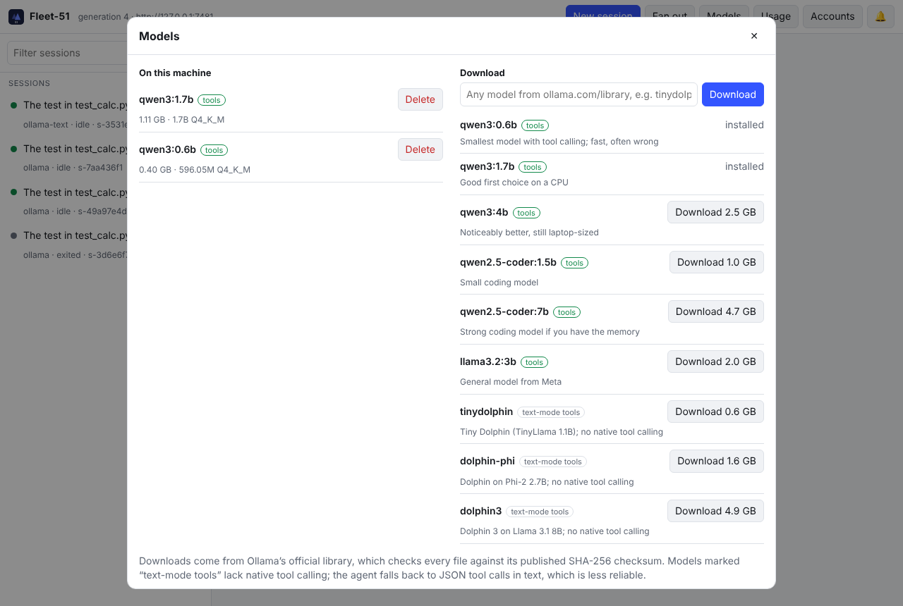

# Fleet-51

Run a fleet of coding agents (Claude Code, Codex, Ollama, any ACP agent, or any terminal agent) from
one small headless daemon. Watch them side by side in a browser or on your phone, review their
diffs, send line comments back as feedback, and merge the winner.

Fleet-51 started as a teardown of [Orca](https://github.com/stablyai/orca). That analysis, and
what Fleet-51 does differently, is in [`docs/orca-teardown.md`](docs/orca-teardown.md). This is
an early, rough demo.


| Compare attempts | Review and comment | Phone |
|---|---|---|
|  |  |  |


## Install on a Mac (no Rust needed)

Every push builds a universal macOS app (Apple Silicon and Intel) in GitHub Actions:

1. Open the repo's **Actions** tab, pick the latest **Build** run, and download the
   **Fleet-51-macos** artifact (a zip containing `Fleet-51-macos.dmg`). Tagged versions
   (`v0.1.0`, …) also attach the `.dmg` to the GitHub release.
2. Open the `.dmg` and drag **Fleet-51** to Applications.
3. The app is not signed by Apple yet, so the first launch needs right-click › **Open** › **Open**
   (or `xattr -dr com.apple.quarantine /Applications/Fleet-51.app`).
4. Fleet-51 opens in its own window, and starts the background daemon if it isn't running.
   Closing the window leaves agents running; **Quit and Stop Agents** (⌥⌘Q) stops everything. For free local
   models, install [Ollama](https://ollama.com) and use the **Models** panel.

Windows and Linux packages are planned; on Linux, build from source as below.

## Try it from source (no API keys needed)

```bash
cargo build
scripts/demo.sh            # full end-to-end run with offline mock agents
KEEP=1 scripts/demo.sh     # same, then leaves the daemon up and prints the web UI link
```

## Run a fleet of local models with Ollama

Ollama serves models; it is not a coding agent. Fleet-51 includes a small coding agent
(`fleet51 agent`) that uses the model through Ollama's API. It can list, read, search, write and
edit files and run commands, all confined to the session's workspace.

Download models from the **Models** panel in the web UI. It lists what Ollama has, marks which
models can call tools, and shows suggested small models with a download button and live progress.
You can also type any name from [ollama.com/library](https://ollama.com/library). Downloads go
through Ollama's own pull, which checks every file against its published SHA-256 checksum. The
same works from the terminal:



```bash
fleet51 up
fleet51 models pull qwen3:1.7b                   # download with progress (or: tinydolphin, dolphin-phi…)
fleet51 models                                   # what Ollama has locally, and which can call tools
fleet51 models rm qwen3:1.7b
fleet51 run ollama --model qwen3:1.7b --repo . -p "fix the failing test" --wait
fleet51 fanout --agents ollama --models qwen3:0.6b,qwen3:1.7b -n 2 --repo . -p "add input validation"
fleet51 compare g-1234abcd                       # which model did best
```

Leave out `--model` to use the first model Ollama has. The `openai-compatible` agent does the same
against LM Studio, vLLM, llama.cpp server or OpenRouter (set `OPENAI_BASE_URL`, plus
`OPENAI_API_KEY` if needed). The model must support tool calling. Small local models are much
weaker than hosted ones, so compare several and review before merging.

- Reasoning models such as qwen3 have thinking turned off by default on Ollama. In testing that
  made replies about 50 times faster on CPU. Pass `--think` in a custom manifest to turn it back on.
- Models without native tool calling (for example the dolphin family) still work. The agent
  notices, then asks the model to write each tool call as a JSON object in its reply. You can force
  this with `--tool-mode text`. It is less reliable than native tool calling.

## Use it

```bash
export PATH="$PWD/target/debug:$PATH"
fleet51 up                                   # start the daemon (127.0.0.1:7451)
fleet51 url                                  # web UI link with token; open it anywhere
fleet51 agents                               # what is installed

fleet51 run claude --repo ~/code/app -p "fix the flaky test" --wait
fleet51 fanout --agents claude,codex -n 2 --repo ~/code/app -p "add dark mode"
fleet51 compare g-1234abcd                   # files, lines, cost, last message per attempt
fleet51 diff s-1234abcd
fleet51 annotate s-1234abcd src/theme.ts:42 "use the existing token instead"
fleet51 feedback s-1234abcd                  # all unsent comments become one prompt
fleet51 merge s-1234abcd                     # commit on the agent's branch, merge into yours

fleet51 ws create fullstack ~/code/web ~/code/api   # multi-repo workspace
fleet51 run claude --ws w-1234abcd -p "wire the web app to the new endpoint"
fleet51 run claude --repo ~/code/app --sandbox docker-offline -p "..."

fleet51 accounts add anthropic work          # then: CLAUDE_CONFIG_DIR=<printed dir> claude
fleet51 run claude --repo . --account auto -p "..."   # fails over on rate limits
fleet51 usage
fleet51 down                                 # suspends sessions; `fleet51 up` resumes them
```

For remote use, run `fleet51 daemon --listen 0.0.0.0:7451` on the host. Then point the CLI at it
with `FLEET51_URL` and `FLEET51_TOKEN`, or open the `fleet51 url` link over a private network
such as Tailscale or WireGuard.

## Adding an agent

```toml
# ~/.fleet51/agents/my-agent.toml
name = "my-agent"
protocol = "acp"            # claude-stream-json | codex-exec-json | acp | pty
command = ["my-agent", "--acp"]
rate_limit_pattern = "(?i)rate limit"

# For terminal-only agents:
# protocol = "pty"
# [pty]
# ready_pattern = "> $"     # prompts wait for this; captured from a real transcript
# idle_pattern = "> $"
```

See `agents/` for the built-in manifests, including permission modes, resume flags,
per-session config overlays, account directories and sandbox images.

## Layout

| Path | What |
|---|---|
| `src/events.rs` | Session event log and the state fold |
| `src/session.rs` | Per-session supervisor: spawn, resume, account failover, config overlay |
| `src/adapters/` | Claude stream-json, Codex exec-json, ACP, PTY |
| `src/daemon.rs` | Generation handoff, crash recovery, session management |
| `src/server.rs` | HTTP API, event streams, embedded UI |
| `src/workspace.rs`, `src/review.rs` | Checkouts, diffs, feedback, merge |
| `src/accounts.rs`, `src/sandbox.rs` | Accounts and isolation tiers |
| `src/mock.rs` | Offline mock agent for every protocol |
| `ui/` | Web UI / PWA (no build step) |

## Status

This is a rough demo. The mock agents run end to end. With Ollama on a 4-core CPU and no GPU,
qwen3:1.7b fixed a real failing test in 49 seconds: it read the file, edited it and ran the test.
qwen3:0.6b was faster but claimed success on a test that still failed. Expect small local models
to need several attempts, which is what fan-out and compare are for.
real agents follow their documented flags but are untested here. Known gaps are listed at the
end of [`docs/orca-teardown.md`](docs/orca-teardown.md).
