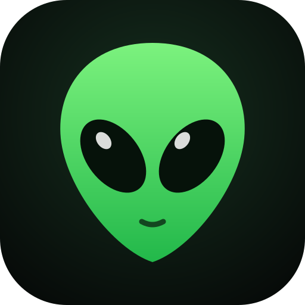
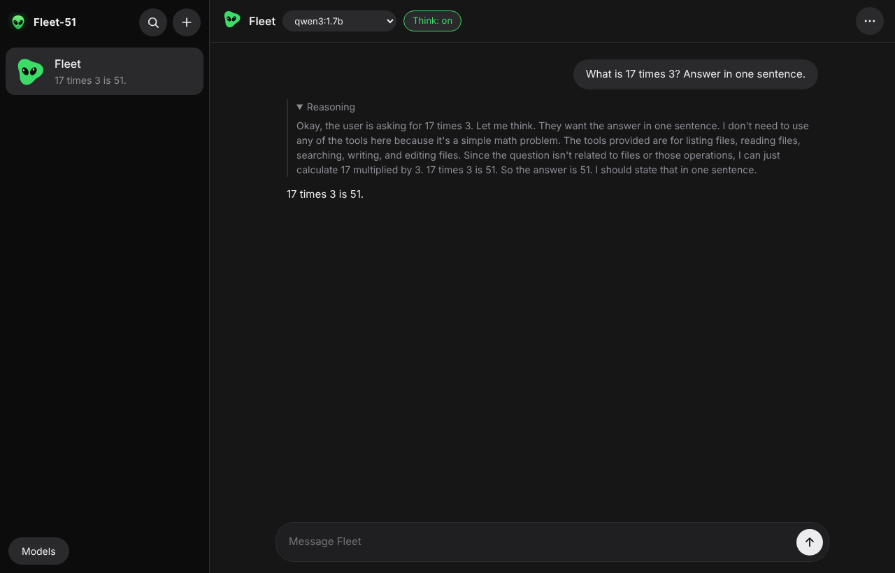
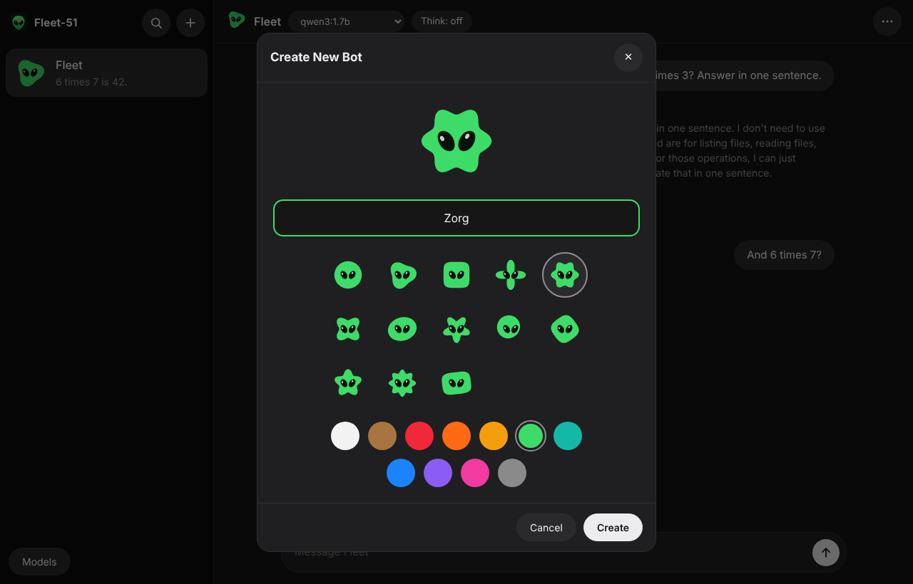
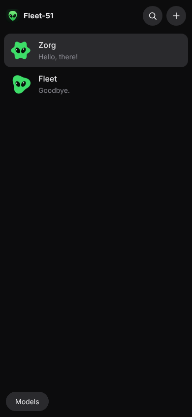

<p align="center"></p>

<h1 align="center">Fleet-51</h1>

<p align="center"><b>Your own fleet of alien AI bots, running privately on your computer.</b><br>
Create a bot, give it a name and a face, pick a free model, and chat. Run as many as you like at once.</p>

<p align="center"><a href="https://github.com/noisyloop/Fleet-51/releases/latest/download/Fleet-51-macos.dmg"><b>Download for Mac</b></a> · Apple Silicon and Intel · free and open source</p>



| Create a bot | On a phone |
|---|---|
|  |  |

## What it does

- **Create a bot in seconds:** a name, one of 13 alien shapes and a colour. That's it.
- **Many bots at once:** each bot keeps working while you chat with another. Open a bot in its own
  window (⋯ › Open in new window) to have several conversations side by side.
- **Pick a model per bot:** choose from the menu at the top of the chat, and download more free models
  from **Models**. Bots on different models run at the same time.
- **See the thinking:** models that reason show it in a collapsible **Reasoning** section. Turn
  **Think** off for faster replies.
- **Private:** everything runs on your computer through [Ollama](https://ollama.com). No account, no
  cloud, no telemetry.
- **Safe by design:** each bot has its own folder (`~/Fleet-51/<bot name>`) and can only read and write
  files there. Bots cannot run programs or reach anything else on your computer.

## Install on a Mac

1. Download **[Fleet-51-macos.dmg](https://github.com/noisyloop/Fleet-51/releases/latest/download/Fleet-51-macos.dmg)**
   (or pick a version from [Releases](https://github.com/noisyloop/Fleet-51/releases)).
2. Open it and drag **Fleet-51** to Applications.
3. The app isn't signed by Apple yet, so the first time right-click it › **Open** › **Open**, or run:
   ```bash
   xattr -dr com.apple.quarantine /Applications/Fleet-51.app
   ```
4. Open Fleet-51. The first launch sets everything up by itself:
   - it uses Ollama if you already have it; otherwise it downloads Ollama (about 175 MB) and checks it
     against a SHA-256 built into Fleet-51;
   - it downloads a first model, qwen3:1.7b (about 1.4 GB);
   - it opens your first bot, **Fleet**.

Closing the window leaves your bots running in the background. **Fleet-51 › Quit and Stop Bots**
(⌥⌘Q) stops everything. Updating is just installing a newer `.dmg`; the new version takes over from
the old one and keeps your bots and chats.

Windows and Linux packages are planned. On Linux you can build from source (below) with Ollama
installed.

## Build from source

```bash
cargo build --release
target/release/fleet51 up       # start the background service (finds or starts Ollama)
target/release/fleet51 url      # link to open Fleet-51 in a browser
target/release/fleet51 models pull qwen3:4b
scripts/smoke.sh                # end-to-end test against a stand-in Ollama
```

## How it works

| Part | What it does |
|---|---|
| `src/daemon.rs` | Background service: owns the bots, model downloads and the model engine; a newer build takes over from an older one |
| `src/session.rs`, `src/events.rs` | Each bot is an append-only event log plus a supervisor that runs its agent; replies, reasoning and status are read from the log |
| `src/agent.rs` | The bot itself: talks to the Ollama model, with file tools confined to the bot's folder |
| `src/runtime.rs`, `src/models.rs` | Finds, downloads (checksum-verified) and starts Ollama; lists and downloads models |
| `ui/` | The chat app (no build step), shown in the Mac app's window or any browser |
| `packaging/macos/` | The native Mac app and `.dmg` packaging, built by GitHub Actions |

Fleet-51 began as a teardown of [Orca](https://github.com/stablyai/orca); the analysis is in
[`docs/orca-teardown.md`](docs/orca-teardown.md).

## Coming later

Scheduled jobs (a bot that runs a task every morning, such as a daily summary or code check),
Windows and Linux packages, and signed builds.
